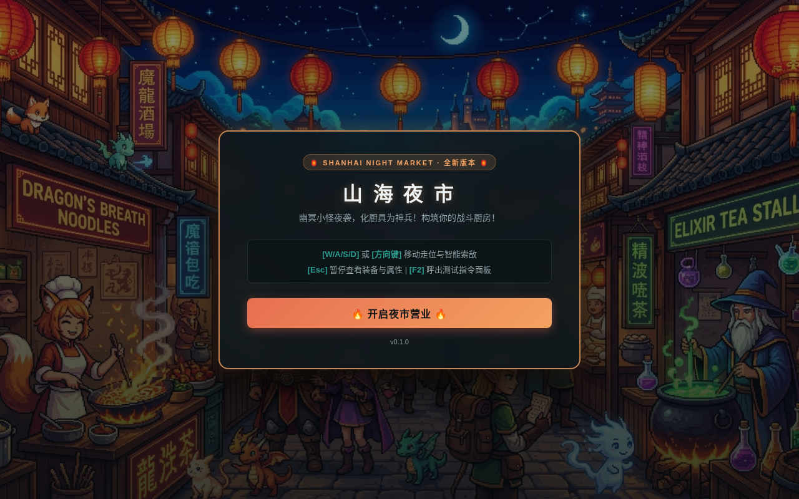
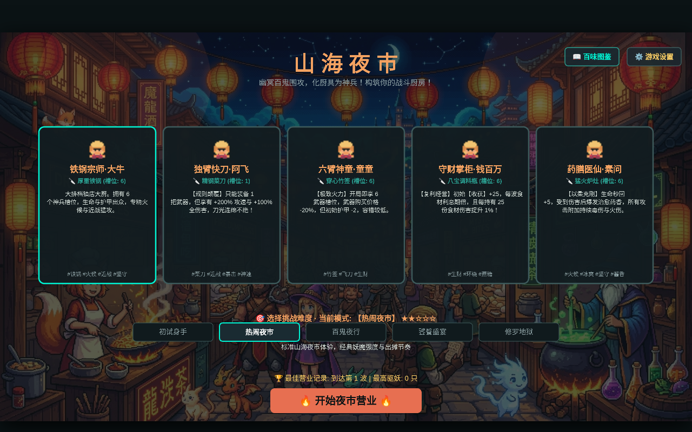

<p align="right"><a href="README.md">中文</a></p>

<p align="center">
  
</p>

<p align="center">
  <a href="https://holynova.github.io/web-survivor-game-agy/">▶ Play Online</a>
  ·
  <a href="https://github.com/holynova/web-survivor-game-agy">GitHub Repository</a>
</p>

Shanhai Night Market is a 2D top-down "battle kitchen" survivor game: you play a night-market stall owner, weaving through waves of demons, auto-attacking, collecting heat (XP) and ingredients (coins), and combining cookware with flavors into an absurd battle kitchen — across 12 waves of ghosts and a final Taotie boss. A run lasts 10–15 minutes. Built with Phaser 4 + TypeScript + Vite.

## Screenshots

<p align="center">
  
</p>

<p align="center">
  
</p>

## How to Play

- **Move**: `W` `A` `S` `D` or arrow keys; on touch, swipe the left half of the screen to summon a floating virtual joystick. Attacks are automatic — you just position yourself.
- **Level up & build**: kills drop 「热度」 (heat) to level up; each level-up offers a pick-1-of-3 choice of cookware or flavors. Between waves there's a night-market prep (shop) phase to spend 「食材」 (ingredients) on gear.
- **12 waves + boss**: wave 12 is the boss fight — the 夜市饕餮王 (Night Market Taotie King). After death or victory, you can restart quickly.
- **Pause**: `Esc`; debug panel: `` ` `` (invincibility, ingredient spawns, wave skips, 2× speed, and more).

## Content

All counts are from the data files under `src/content/`:

- **5 stall owners**: 铁锅宗师·大牛 (Iron Pot Master Dan Niu — Heavy Iron Pot, 6 divine-weapon slots, outstanding HP and armor), 独臂快刀·阿飞 (One-Armed Swift Blade A Fei — Fine Steel Cleaver, can equip only 1 weapon, but attack speed +200% and all damage +100%), 六臂神童·童童 (Six-Armed Prodigy Tong Tong — Piercing Bamboo Skewer, starts with 6 weapon slots, weapon prices −20%), 守财掌柜·钱百万 (Miserly Shopkeeper Qian Baiwan — Eight-Treasure Seasoning Bottle, starting harvest +25, ingredient interest doubles each wave), 药膳医仙·素问 (Medicinal Cuisine Immortal Su Wen — Fierce Flame Stove, HP regen +5/s, a burst of healing herbal fragrance when hit, attacks add poison and fire damage).
- **10 cookware weapons** (3 levels each): 厚重铁锅 (Heavy Iron Pot — melee fan sweep), 精钢菜刀 (Fine Steel Cleaver — boomeranging flying knives), 穿心竹签 (Piercing Bamboo Skewer — piercing thrusts), 猛火炉灶 (Fierce Flame Stove — burning ground), 八宝调料瓶 (Eight-Treasure Seasoning Bottle — orbiting shield), 唤灵上菜铃 (Spirit-Summoning Serving Bell — summons helper ghost cooks), 八卦游龙铲 (Bagua Dragon Spatula), 金玉爆米花机 (Golden Jade Popcorn Machine), 冰魄玉泉壶 (Ice Soul Jade Spring Pot), 乾坤聚味瓮 (Cosmic Flavor-Gathering Urn).
- **15 flavors** (passives/traits): 朝天红辣椒 (Heaven-Facing Red Chili), 重辣魔鬼粉 (Devil's Hot Powder), 老窖碎冰块 (Old Cellar Crushed Ice), 老坛十年陈醋 (Ten-Year Aged Vinegar), 纯香芝麻油 (Pure Sesame Oil), 纯金大炒勺 (Pure Gold Wok Ladle), 古法红蔗糖 (Traditional Brown Cane Sugar), 暴食铁胃 (Glutton's Iron Stomach), 特酿豆瓣酱 (Specially Brewed Doubanjiang), 老竹小蒸笼 (Old Bamboo Steamer), 紫皮独头蒜 (Purple Single-Clove Garlic), 阴阳八角茴 (Yin-Yang Star Anise), 当归滋补草 (Angelica Tonic Herb), 枸杞养生酒 (Goji Health Wine), 招财金灵猫 (Fortune-Beckoning Golden Cat).
- **6 divine recipes** (tag evolutions): triggered by specific cookware + flavor tag combos — 爆炒火环 (Stir-Fry Fire Ring), 冰镇串烧 (Iced Skewers), 拔丝烈焰 (Candied Flame), 热油飞刀狂澜 (Hot-Oil Flying Blade Frenzy), 老酱醒神铃 (Old Sauce Spirit Bell), 金汤调料阵 (Golden Broth Seasoning Array).
- **11 enemy types**: 饥饿游魂 (Hungry Wandering Ghost), 麻辣泥怪 (Mala Mud Monster), 引魂灯笼 (Soul-Guiding Lantern), 狂暴野猪灵 (Raging Boar Spirit), 离火幽巫 (Li-Fire Phantom Witch), 地沟油怪 (Gutter-Oil Monster), 偷串鼠妖 (Skewer-Stealing Rat Demon), 蒸汽魅影 (Steam Phantom), 大包子妖魔 (Giant Baozi Demon), 火锅煞将 (Hotpot Doom General), and the boss 夜市饕餮王 (Night Market Taotie King).
- **5 difficulty levels**: 初试身手 (First Steps), 热闹夜市 (Bustling Night Market), 百鬼夜行 (Night Parade of Demons), 饕餮盛宴 (Taotie Feast), 修罗地狱 (Asura Hell).

## Run Locally

```bash
pnpm install
pnpm dev        # dev server, default port 3000
pnpm build      # production build, outputs to dist/
pnpm test       # Vitest unit tests
pnpm test:e2e   # Playwright end-to-end tests
pnpm typecheck  # TypeScript strict type checking
pnpm lint       # ESLint
```

## Tech

- **Engine**: Phaser 4.2.1 (exact version pinned) + TypeScript (strict) + Vite 5; Zod validates all content.
- **Performance**: a fixed 60Hz step simulation clock (`SimulationClock`, max 4 catch-up steps per frame); a seeded PRNG (Mulberry32, reproducible from the same seed); a 2D spatial-hash grid (`SpatialHash`) for collision neighbor queries; enemies, projectiles, drops, and damage numbers are all pooled.
- **Architecture**: a strongly typed event bus (`EventBus`) decouples simulation from rendering; all content is data-driven (`src/content/`, Zod schemas + cross-table reference checks); localStorage saves carry structural validation and version migration.
- **Presentation**: Web Audio synthesized sound effects (unlocked on first interaction gesture); a floating touch joystick on mobile, with 960×540 FIT viewport scaling.

```
index.html                  Entry and start screen (with cover art)
src/main.ts                 Game startup
src/game/scenes/           Boot / Preload / Menu / Run / Results
src/game/systems/           Collision / movement / weapons / waves / recipes / synergies / status / spawning
src/game/entities/          Player / enemies / projectiles / drops / damage numbers
src/game/ui/                HUD / upgrades / shop / pause / settings / compendium / debug
src/content/                Data: characters / enemies / weapons / flavors / recipes / waves / difficulties
public/assets/              Character / enemy / item sprites, SFX and BGM, cover art
tests/                      Vitest unit tests + Playwright end-to-end tests
```
