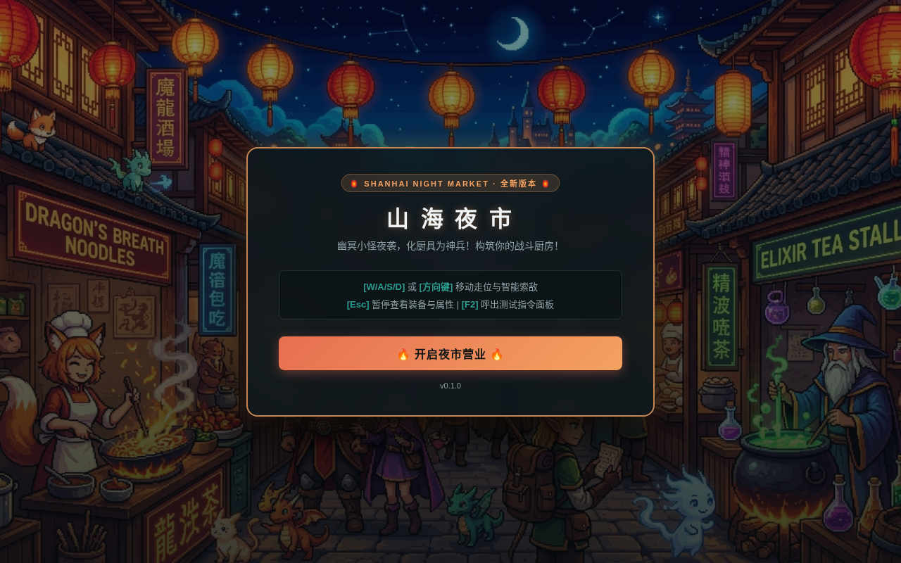
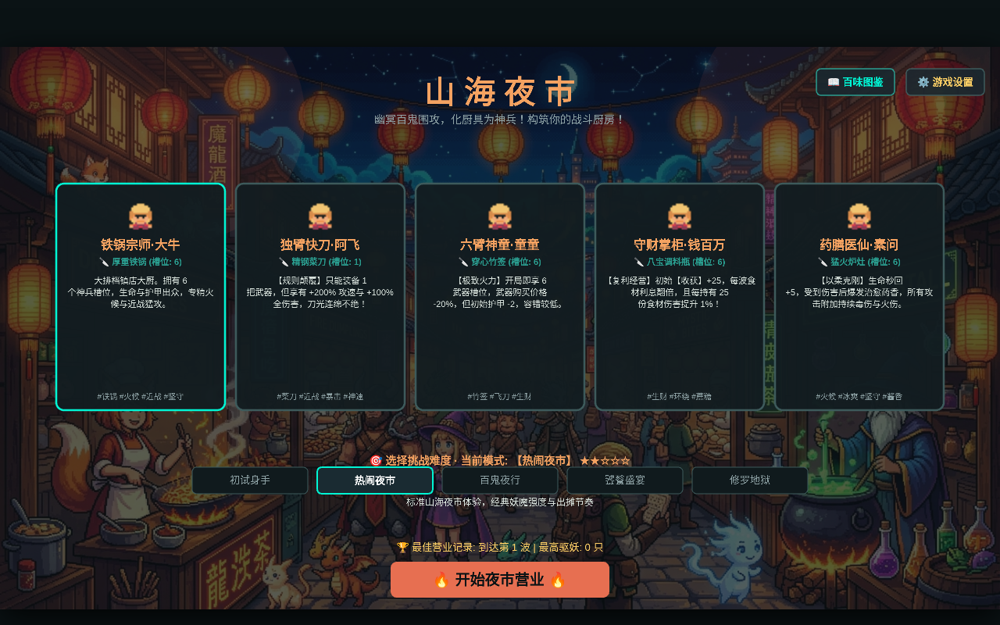

<p align="right"><a href="README.en.md">English</a></p>

<p align="center">
  
</p>

<p align="center">
  <a href="https://holynova.github.io/web-survivor-game-agy/">▶ 在线玩</a>
  ·
  <a href="https://github.com/holynova/web-survivor-game-agy">GitHub 仓库</a>
</p>

山海夜市是一款 2D 俯视角「战斗厨房」幸存者游戏：你扮演一名夜市摊主，在妖怪围攻的山海夜市中穿梭移动、自动攻击，收集「热度」（经验）与「食材」（金币），把厨具与口味组合成夸张的战斗厨房，挑战 12 波幽冥百鬼与最终的饕餮 Boss。单局 10~15 分钟，Phaser 4 + TypeScript + Vite 构建。

## 截图

<p align="center">
  
</p>

<p align="center">
  
</p>

## 玩法

- **移动**：`W` `A` `S` `D` 或方向键；触屏左半屏滑动唤起跟手虚拟摇杆。攻击全自动，你只管走位。
- **升级与构筑**：杀怪掉「热度」升级，升级三选一拿厨具或口味；波次间有夜市整备（商店）时间，用「食材」买装备。
- **12 波 + Boss**：第 12 波是 Boss 战——夜市饕餮王。死亡或胜利后可快速重开。
- **暂停**：`Esc`；调试面板：`~`（无敌、刷食材、跳波、2x 加速等）。

## 内容

数量均按 `src/content/` 下的数据文件实数：

- **5 位摊主**：铁锅宗师·大牛（厚重铁锅，6 神兵槽位、生命护甲出众）、独臂快刀·阿飞（精钢菜刀，只能装备 1 把武器，但攻速 +200%、全伤害 +100%）、六臂神童·童童（穿心竹签，开局即享 6 武器槽位、武器购买价 -20%）、守财掌柜·钱百万（八宝调料瓶，初始收获 +25、每波食材利息翻倍）、药膳医仙·素问（猛火炉灶，生命秒回 +5、受击爆发治愈药香、攻击附毒伤与火伤）。
- **10 件厨具**（武器，各 3 级）：厚重铁锅（近战扇面横扫）、精钢菜刀（飞刀回旋）、穿心竹签（穿透疾刺）、猛火炉灶（地面燃烧）、八宝调料瓶（环绕护体）、唤灵上菜铃（召唤帮厨小幽灵）、八卦游龙铲、金玉爆米花机、冰魄玉泉壶、乾坤聚味瓮。
- **15 种口味**（被动/词条）：朝天红辣椒、重辣魔鬼粉、老窖碎冰块、老坛十年陈醋、纯香芝麻油、纯金大炒勺、古法红蔗糖、暴食铁胃、特酿豆瓣酱、老竹小蒸笼、紫皮独头蒜、阴阳八角茴、当归滋补草、枸杞养生酒、招财金灵猫。
- **6 道神厨菜谱**（标签质变）：达成特定厨具 + 口味标签触发——爆炒火环、冰镇串烧、拔丝烈焰、热油飞刀狂澜、老酱醒神铃、金汤调料阵。
- **11 种敌人**：饥饿游魂、麻辣泥怪、引魂灯笼、狂暴野猪灵、离火幽巫、地沟油怪、偷串鼠妖、蒸汽魅影、大包子妖魔、火锅煞将，以及 Boss 夜市饕餮王。
- **5 档难度**：初试身手、热闹夜市、百鬼夜行、饕餮盛宴、修罗地狱。

## 本地运行

```bash
pnpm install
pnpm dev        # 开发服务器，默认端口 3000
pnpm build      # 生产构建，输出至 dist/
pnpm test       # Vitest 单元测试
pnpm test:e2e   # Playwright 端到端测试
pnpm typecheck  # TypeScript 严格类型检查
pnpm lint       # ESLint
```

## 技术

- **引擎**：Phaser 4.2.1（精确版本锁定）+ TypeScript（strict）+ Vite 5；Zod 做全量内容校验。
- **性能**：固定 60Hz 步长模拟时钟（`SimulationClock`，单帧最多 4 步补算）；带种子的 PRNG（Mulberry32，相同 Seed 可重现）；2D 空间哈希网格（`SpatialHash`）做碰撞近邻查询；敌人、投射物、掉落物、伤害飘字全量对象池化。
- **架构**：强类型事件总线（`EventBus`）解耦模拟与渲染；内容全部数据驱动（`src/content/`，Zod Schema + 跨表引用检查）；localStorage 存档带结构校验与版本迁移。
- **表现**：Web Audio 动态合成音效（首次交互手势解锁）；移动端跟手虚拟摇杆，960×540 FIT 视口缩放。

```
index.html                  入口与开始界面（含封面图）
src/main.ts                 游戏启动
src/game/scenes/           Boot / Preload / Menu / Run / Results
src/game/systems/           碰撞 / 移动 / 武器 / 波次 / 菜谱 / 协同 / 状态 / 生成
src/game/entities/          玩家 / 敌人 / 投射物 / 掉落物 / 伤害飘字
src/game/ui/                HUD / 升级 / 商店 / 暂停 / 设置 / 图鉴 / 调试
src/content/                数据：角色 / 敌人 / 武器 / 口味 / 菜谱 / 波次 / 难度
public/assets/              角色 / 敌人 / 道具精灵、音效与 BGM、封面图
tests/                      Vitest 单元测试 + Playwright 端到端测试
```
